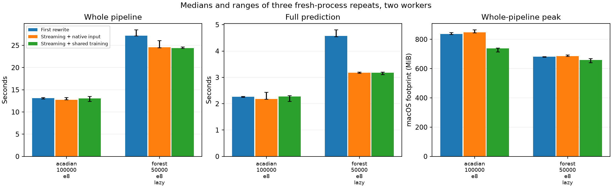

# Prediction, profiling and modular calibration

This second pass on `codex-rewrite` adds streaming ensemble means and standard deviations, faster rectangular selection, optional read-only lazy predictions, and independent calibration/tuning components. It extends the [first execution rewrite](REWRITE.md), rather than replacing its compatibility rules or benchmarks.

The measured gains depend on the workload. In three repeated lazy-forest runs, prediction was about 31% faster and complete-job time about 10% lower than the first rewrite. Small XGBoost jobs changed little. Streaming greatly reduces the aggregation buffer, but does not bound estimator workspace or guarantee a comparable reduction in complete-job peak memory.

## Bounded prediction inputs, October 10, 2026

The HPC occurrence log showed successful training and held-out prediction, followed
by SIGKILL during annual prediction before any ensemble finished. That is consistent
with a memory-limit kill, although Slurm accounting is needed to confirm its cause.
The log's repeated 192,909.8 MiB peak belongs to the entire workflow; it is not a
prediction-stage peak. Summed process RSS also counts shared pages repeatedly.

The previous streaming reducer already avoided an N-by-ensemble matrix in the
parent. Each worker still materialized a full, wide temporal window as Pandas data.
The new opt-in `prediction_batch_size` bounds that conversion while retaining
`temporal_window_prequery=True`: one query per window yields successive Arrow
batches, each passed through the same rotation, half-open stixels and base models.
Workers remain parallel. Missing models are skipped before constructing their
stixel covariate copies. No full prediction-input copy is written to scratch.
DuckDB documents the [Arrow batch reader](https://duckdb.org/docs/lts/guides/python/export_arrow);
the separate parent-side reducer follows the same incremental-output principle
described in [joblib's generator example](https://joblib.readthedocs.io/en/stable/auto_examples/parallel_generator.html).

A synthetic wide-input comparison used 1,000,000 prediction rows, 116 random
covariates plus longitude, latitude and DOY, four ensembles, two loky workers,
lazy models and local ridge-100 beta calibration around XGBoost. Models had
10 trees per calibration fold and were fitted once on 10,000 rows; identical
model files were reused for every prediction variant. This measures execution
equivalence and prediction costs, not whether the calibration is scientifically
optimal. Each variant ran three times in fresh processes, alternating order.

| Temporal-query batch | Median prediction time | Median peak process-tree physical footprint | Median peak summed RSS |
| --- | ---: | ---: | ---: |
| Full window | 7.73 s | 3.29 GiB | 5.76 GiB |
| 100,000 rows | 9.03 s | 1.85 GiB | 4.51 GiB |
| 50,000 rows | 10.35 s | 1.69 GiB | 3.99 GiB |

The 100,000-row choice reduced the median sampled footprint by **43.8%** at a
**16.8%** time cost. The 50,000-row choice saved 48.8% but took 33.9% longer.
All probabilities and standard deviations agreed within 5.56e-17; missing masks
and coverage were identical. These are Apple Silicon measurements (Python
3.13.15, NumPy 2.5.1, Pandas 3.0.5, DuckDB 1.5.5, scikit-learn 1.9.0, XGBoost
3.3.0), sampled every 50 ms. Mac physical footprint and Linux PSS/Slurm charges
are different measurements. Shared filesystem model loading and larger stixels
can change the speed trade-off on HPC, so these percentages are not a server
memory guarantee. Model workspace, DuckDB caches and ensemble output buffers
remain additional allocations; the row limit is not a total job RAM cap.

The package defaults to `prediction_batch_size=None` for compatibility with
custom batch-dependent and stateful prediction methods. The project occurrence
runner defaults to 100,000 for its pointwise XGBoost/beta models; `--prediction-batch-size 0`
restores whole windows. Smaller batches can repeat lazy-model loads, which
explains part of the time cost. Custom ensemble overrides reject batching
explicitly; separate-ensemble/median returns retain their full result matrix.

Raw results: [calibrated.json](../data/00_benchmarks/prediction_batches/calibrated.json).
The comparison removes temporary databases, models and prediction arrays.
Validation passed 76 checks on Python 3.13 covering batching, streaming, calibration
and both project runners, plus six focused Python 3.14 checks. The batch reader
tests cover the older DuckDB API fallback, early reader cleanup, one query per
window, private estimator row workspaces, nonconsecutive/reversed observation IDs,
overlapping windows, intentional dummy predictions and matching missing coverage.

```bash
python scripts/00_benchmarks/compare_prediction_batches.py \
    --rows 1000000 --features 116 --ensembles 4 --jobs 2 \
    --calibrated --batches 0 50000 100000 --repeat 3 \
    --output data/00_benchmarks/prediction_batches/calibrated.json
```

## Public choices

Continue passing `base_model` to `AdaSTEMClassifier` or `AdaSTEMRegressor`. Tuning and calibration are independent:

| Base model | Search | Local calibration |
| --- | --- | --- |
| A user-supplied estimator | No | No |
| `SelfTuningClassifier(estimator, ...)` | Yes | No |
| `CrossValidatedCalibratedClassifier(estimator, ...)` | No | Yes |
| `CrossValidatedCalibratedClassifier(SelfTuningClassifier(...), ...)` | Yes, nested inside calibration training folds | Yes |

All four choices also work outside AdaSTEM. The generic wrappers require neither XGBoost nor Optuna. Explicit `SpatioTemporalKFold` supplies blocked folds; omitted `cv` uses ordinary shuffled folds. Regression wrappers calibrate point means, not intervals or full predictive distributions. See the [usage guide](../docs/Tips/Local_calibration_and_tuning.md) and [executed notebook](../docs/Examples/11.Local_calibration_and_profiling.ipynb).

The short recipe `local_beta_xgboost(tuning=False)` calibrates fixed-parameter XGBoost; `tuning=True` adds the supplied small nested search. No new AdaSTEM task string is needed. Intentional dummy zero/one stixels still bypass the wrapper, and missing coverage remains missing.

Examples explicitly show `Spatio_blocks_count=5` and `Temporal_blocks_count=5`. Both are also configurable factory inputs, forwarded to calibration and nested tuning; compose the wrappers directly to use different granularities for those stages. Defaults retain the original cutpoint behavior and do not change the measurements below.

The factory also exposes `n_splits=3` for calibration and `tuning_n_splits=2` for nested tuning. These are independent of block counts. Changing calibration folds changes the number of retained fold models and its time/storage cost; changing tuning folds changes search work. Default values preserve the measured recipe.

## Execution changes

- Mean aggregation consumes completed ensembles using per-row counts and Welford moments. Finite-output accumulators use 12 bytes per row for means, or 20 bytes for means and standard deviations, independent of ensemble count. IDs, current worker results, output arrays and queued results are additional memory. Standard deviations retain `ddof=1`, and logit aggregation reports standard deviation on the logit scale.
- Median aggregation, separate-ensemble returns and custom `SAC_predict` overrides retain the matrix route. `streaming=False` selects it explicitly. Streaming uses double-precision arithmetic, so float32 estimator results can differ by rounding rather than bitwise equality.
- A sorted spatial coordinate index reduces candidate scans for sufficiently large windows. Half-open boundaries and source row order are preserved. Bootstrap occurrences are selected once with their intended multiplicity.
- Shared numeric inputs construct Pandas blocks by dtype, avoiding repeated per-column insertion and fragmentation. Estimators still receive Pandas stixel data. DuckDB remains available and source connections remain read-only; temporal-window prequery is preserved.
- Constant-feature filtering computes column standard deviations once instead of once per feature. This optimization applies when `subset_x_names=True`.
- Lazy prediction can release a loaded estimator without writing it again. **Compatibility default:** `fit(..., persist_prediction_state=True)` retains legacy persistence for arbitrary estimators that mutate during prediction. Explicit `False` enables read-only prediction for known compatible estimators. The measurements below use `False` in new variants and legacy persistence in the baseline; prediction gains therefore describe the combined changes, not streaming alone.

No automatic hard memory cap is imposed. `max_mem` is still a DuckDB buffer budget. A large estimator, nested search or retained calibration fold models can dominate memory despite smaller data/aggregation buffers. Worker concurrency can still be selected separately from ensemble count.

## Repeated complete-job measurements

Baseline is the **first rewrite commit `53dc476`**, already containing shared-training support and bounded task dispatch. It differs from the older merged baseline `368acf6` used in `REWRITE.md`. The new native variant uses native DuckDB training; the new shared variant enables the existing memmap training option with the new block construction. Shared/native differences must not all be attributed to new streaming aggregation.

Each case ran three times, each variant in a fresh process, with two workers and eight ensembles. Input preparation, partitioning, fitting, held-out prediction, metric evaluation and full prediction occur in the same job. Matplotlib's font cache was warmed consistently before measured variants. Detailed line/allocation tracing was off in these timing runs. The sampler traverses children and grandchildren (`sampler_version=2`). Scratch inputs, fitted models and memory maps were removed after each run.

The real Acadian fixture has 100,000 checklists and 116 numeric predictors from DOY 121–200. Its small XGBoost uses 20 trees and depth 4. The synthetic forest fixture has 50,000 rows and 35 predictors, with 40 trees and depth 12. Both use lazy loading. Fixed common held-out splits here test execution equivalence, not spatial generalization or calibration quality.

Host: Apple Silicon macOS 15.7.7; Python 3.13.15, NumPy 2.5.1, Pandas 3.0.5, DuckDB 1.5.5, sklearn 1.9.0 and XGBoost 3.3.0. MiB is 2^20 bytes. Footprint is the maximum sampled sum of macOS process physical footprints; summed RSS can count shared pages repeatedly. Neither is Linux Slurm cgroup memory.

| Case | Variant | Complete job s, median [range] | Fit s | Held-out prediction s | Full prediction s | Peak footprint MiB | Peak summed RSS MiB |
| --- | --- | ---: | ---: | ---: | ---: | ---: | ---: |
| Acadian 100k | First rewrite, native | 13.13 [12.91–13.25] | 5.30 | 1.91 | 2.26 | 836 | 2164 |
| Acadian 100k | New native | 12.71 [12.71–13.23] | 5.37 | 1.84 | 2.18 | 847 | 2045 |
| Acadian 100k | New shared | 13.04 [12.40–13.50] | 5.50 | 1.85 | 2.27 | 737 | 1928 |
| Forest 50k | First rewrite, native | 27.20 [27.12–28.49] | 15.77 | 4.39 | 4.57 | 681 | 1290 |
| Forest 50k | New native | 24.59 [24.46–26.08] | 15.87 | 3.02 | 3.18 | 685 | 1239 |
| Forest 50k | New shared | 24.36 [24.35–24.66] | 15.85 | 3.01 | 3.17 | 659 | 1255 |

Peak memory columns are medians of per-run complete-job maxima, not sums of phase maxima. The native variants do **not** show a complete-job footprint improvement here: training still determines the peak. Shared Acadian footprint is about 12% below the native baseline, while total time is similar.

The numerical comparison passed for every repeat: missing-coverage masks agree, and the largest mean prediction difference is 2.22e-16. Float32-specific tests and exploratory workloads use a stated 1e-6 comparison tolerance; they are not claimed to be bitwise identical.



Raw reports: `data/00_benchmarks/streaming_prediction/repeated/`; compact medians/ranges: `repeated_summary.json`. Older exploratory reports outside `repeated/` include cold-start effects and are not used for complete-job timing claims above.

### Phase and payload attribution

| Case / variant | Train footprint MiB | Prediction footprint MiB | Shared input files MiB | Saved model files MiB | Largest model file MiB |
| --- | ---: | ---: | ---: | ---: | ---: |
| Acadian / first native | 836 | 705 | 0 | 3.87 | 0.044 |
| Acadian / new native | 847 | 715 | 0 | 3.87 | 0.044 |
| Acadian / new shared | 706 | 737 | 36.35 | 3.87 | 0.044 |
| Forest / first native | 681 | 673 | 0 | 120.24 | 0.447 |
| Forest / new native | 685 | 674 | 0 | 120.24 | 0.447 |
| Forest / new shared | 613 | 659 | 11.30 | 120.24 | 0.447 |

These quantities overlap. Shared-file size and saved-model size are disk payloads, not extra additive RAM charges. Model serialization size is not fitted model resident memory. Parent/descendant RSS, stixel DataFrame payload, active fitting increases and preparation times are also retained in raw JSON. Generic before/after fitting RSS cannot isolate every native XGBoost/forest workspace or allocator-retained page; process-tree sampling supplies the broader peak estimate.

### Aggregation in isolation

Three fresh-process probes generated 500,000 predictions for each of 50 ensembles, then calculated means and standard deviations. This deliberately isolates aggregation from fitting and database queries:

| Route | Logical persistent prediction buffer | Median aggregation s | Median process footprint MiB |
| --- | ---: | ---: | ---: |
| Dense float64 matrix | 200 MB | 0.559 | 881 |
| Online moments | 10 MB | 0.443 | 88 |

This is a **20-fold buffer reduction**, not a 20-fold complete-job memory claim. Process peaks include imports, generated predictions and aggregation temporaries; the time includes generation and alignment. Mean and standard-deviation checksums agree. Files: `aggregation.json`, `aggregation_repeat2.json`, `aggregation_repeat3.json`.

An additional synthetic 30,000-row constant-filter probe (`subset_x_names=True`, 119 predictors, four ensembles) reduced measured training time from 6.73 s to 4.11 s for new native execution; new shared took 4.39 s plus 0.12 s preparation. Its maximum float32 prediction difference was 5.96e-8. This single exploratory case does not predict gains when constant filtering is disabled.

## Profiling and remaining bottlenecks

Set `STEMFLOW_PROFILE_DIR` to save compact per-process function profiles. `STEMFLOW_PROFILE_LINES=1` adds package line timings; `STEMFLOW_PROFILE_ALLOCATIONS=1` adds Python traced peak allocations and retained allocation lines. Profiling is off by default, restores prior hooks, and does not turn a completed fit into a failure if writing the profile fails.

The 4,000-row/two-ensemble probe saved 18 profiles under `data/00_benchmarks/streaming_prediction/profiles/`. In one shared training worker, instrumented wall time was 1.22 s: stixel fitting occupied about 0.93 s cumulatively, and estimator fitting about 0.56 s. In one prediction worker, wall time was 0.46 s: stixel prediction occupied about 0.30 s, XGBoost prediction about 0.18 s, Pandas-to-XGBoost conversion about 0.14 s, and model loading about 0.04 s. These are nested inclusive times, **not additive partitions**, and tracing overhead changes them.

This supports further attention to estimator input conversion, repeated small model calls and native estimator workspaces. It does not justify removing Pandas or changing arbitrary estimator interfaces without evidence. Python allocation profiles here also contain substantial profiler allocations; they are not native/GPU RAM measurements or per-line peak RSS. Current package line numbers may move after edits; each record retains its source filename and function context.

Use the process-tree sampler for complete-job peaks and the function/line profiles to locate work. Validate production choices on Linux, including Slurm accounting. Multi-node scheduling, GPU allocation and automatic memory admission for arbitrary complex estimators remain outside this validated change.

## Calibration equivalence and quality

The reusable XGBoost recipe matches the supplied helper: three within-stixel blocked OOF folds, two nested tuning folds, sequential small Optuna search, one identity-regularized beta map fitted to pooled OOF scores, and calibration of each retained fold prediction before averaging. Ridge 100 penalizes deviations from `(a,b,c)=(1,1,0)` in `sigmoid(a log(p) − b log(1−p) + c)`, using summed log loss. It is not a universal optimum. No final global beta map or automatic class weighting is added.

On 1,000 synthetic training rows and 400 independent prediction rows, both fixed and tuned recipes matched the original helper exactly: selected hyperparameters, beta coefficients and probabilities. A 12,000-row real Acadian/two-ensemble AdaSTEM comparison against that helper matched predictions within 5.56e-17 and matched missing masks and metrics. See `data/02_calibration/reference_equivalence.json` and `acadian_tuned_beta.json` in the benchmark directory. These validate implementation parity, not optimal calibration or accurate copula recovery.

A separate blocked real-data audit used 8,622 training checklists with **56 detections** and 3,378 held-out rows with 36 detections. All methods had 0.9133 coverage. It used two ensembles and small models, with two Optuna trials for tuned variants:

| Method | AUC | Log loss | Brier | Quantile ECE pp | Quantile relative ECE | Predicted / observed rate |
| --- | ---: | ---: | ---: | ---: | ---: | ---: |
| Raw XGBoost | 0.804 | 0.06190 | 0.01181 | 0.522 | 10.61 | 0.558 |
| Fixed XGBoost + local beta | 0.773 | 0.05782 | 0.01150 | 0.384 | 3.33 | 1.003 |
| Tuned XGBoost + local beta | 0.754 | 0.05801 | 0.01131 | 0.398 | 10.13 | 0.945 |
| Tuned forest + local beta | 0.706 | 0.06114 | 0.01155 | 0.412 | 2.37 | 1.210 |

Overall calibration improves on several measures while AUC declines. No method dominates all metrics. Local scores are far less secure: **none of the 23 fitted stixels has 20 training positives** (maximum 16), and only 15 contain valid held-out predictions. Median local relative scores remain hundreds to thousands and depend strongly on zero-event bins and probability floors. This small audit cannot establish a local winner or justify claiming improved copula correlation. A larger, adequately supported blocked evaluation remains necessary for that scientific conclusion.

Diagnostics now include overall, spatial, temporal, space-time and actual occurrence/copula partition scores; counts and expected detections; AUC/AP, proper losses, relative ECE at two floors and zero-event mass; and training-support versus held-out-support flags. Plots include six-panel diagnostics and log-scale stixel overlays with an equal-stixel mean in common probability intervals. Overlapping stixels are not independent replicates. Relative ECE in tiny zero-event bins should be read alongside support, losses and uncertainty references.

Audit outputs and plots: `data/02_calibration/acadian_small_optuna/` and `figures/02_calibration/acadian_small_optuna/`. The earlier random-search audit is preserved in `acadian_small/` and is not interchangeable with the Optuna candidate sequence.

## Validation and reproduction

The final Python 3.13 validation passed 93 checks spanning streaming, calibration, profiling, shared input preparation, process-tree sampling and selected existing SphereAdaSTEM, hurdle, STEM and custom-method compatibility. Four additional checks passed for the independent fixed/tuned/calibrated/composed choices. Tests cover stateful estimator persistence and its explicit read-only opt-out, bootstrap row multiplicity, half-open boundaries, dtype preservation, missing coverage, logit aggregation, median/separate returns, OOF separation, rare-fold audits, clone/pickle behavior, actual-stixel plots and reference tuning reproducibility.

An additional 26 calibration/composition/streaming checks passed on Python 3.14. The added notebook was rerun on Python 3.14 with real tables and two inline plots, and rendered independently to HTML; original examples remain unchanged. It uses only a small synthetic fixture and removes temporary databases/models. The full MkDocs build requires the project's documentation dependencies, which are absent from this local runtime.

```bash
python -m pytest -q tests/test_prediction_streaming.py tests/test_calibration.py tests/test_execution_profile.py
python scripts/00_benchmarks/run_prediction_matrix.py --repeat 3
python scripts/00_benchmarks/aggregation_scaling.py
python scripts/02_calibration/compare_local_calibration.py --help
python scripts/01_documentation/execute_notebook.py docs/Examples/11.Local_calibration_and_profiling.ipynb --output docs/Examples/11.Local_calibration_and_profiling.ipynb
```

Optional tuning dependencies are in `pip install -e '.[tuning]'`. Generic random search avoids Optuna, and generic calibration avoids XGBoost entirely. Benchmark scripts accept supplied real-data paths and clean their scratch fixtures. Source databases and species Parquet files are opened read-only. No production models or full prediction matrices are retained in these new reports.

## Planar rotation and spatial jitter audit

The evenly spaced setting uses `angle = 90 * ensemble_index / ensemble_fold`.
A 50-ensemble `.split()` audit produced 0, 1.8, 3.6, ..., 88.2 degrees, within
1.42e-14 degrees of that expression. Coordinate round trips, distance preservation
and the correspondence between plotted rectangles and inverse-transformed cells
passed. There is no angle-division or clockwise/counterclockwise plotting error
in these planar paths.

The initial audit identified a separate, pre-existing spatial jitter defect in both `QTree` and
`QuadGrid`: coordinates are shifted by a common offset, then the grid is anchored
to the minimum of those shifted coordinates. Writing rotated coordinates as `z`
and the jitter as `j`, the grid origin becomes `min(z) + j`. Relative positions
are therefore `(z + j) - (min(z) + j) = z - min(z)`. Extents, subdivisions and
inverse-transformed cell locations are unchanged mathematically. Exported
six-decimal rounding and floating-point boundary effects can create tiny
differences; these do not provide the intended random grid phase. This logic was
already present in the merged baseline and predates the execution rewrite.

On 2,400 synthetic points, offsets `(0, 0)` and `(17.25, -31.5)` yielded identical
membership lists in adaptive and fixed grids at 0, 27.5 and 88.2 degrees. The
largest inverse-transformed vertex difference was 1.42e-14 coordinate units.

The audit also isolates angle scheduling using the same observations, without
temporal jitter or bootstrap. Adjacent evenly spaced angles produce much more
similar partitions than adjacent independent random angles. Average similarity
over *all* ensemble pairs is similar for the two schedules in this single
synthetic probe. Adjusted Rand index measures point partition agreement, not
geometric intersection area, prediction correlation or statistical accuracy.
The result supports an ordering effect and missing spatial phase jitter, not a
claim that random angles universally produce a better ensemble.

| Schedule | Mean adjacent-pair ARI | Mean all-pair ARI |
| --- | ---: | ---: |
| Evenly spaced | 0.8390 | 0.4551 |
| Independent random | 0.4621 | 0.4618 |

Each pair uses only observations assigned in both partitions. At most one of
the 2,400 observations per partition was unassigned at a floating-point outer
boundary in this direct spatial probe; counts are retained in the audit.

This initial audit added eight tests without changing production gridding.
The correction described below now randomizes boundaries relative to the
observations. Reordering the same evenly spaced angles changes only the order,
not final ensemble diversity.

Reproduce with `PYTHONPATH=. python scripts/03_gridding/audit_rotation.py` and
`python -m pytest tests/test_gridding_rotation.py -q`. Small numerical outputs
are in `data/03_gridding/rotation_audit/`, and the figure is in
`figures/03_gridding/rotation_audit/rotation_audit.png`. No base models are fitted
or saved by this audit.

## Spatial jitter correction

Both planar grid classes now use jitter to change the origin relative to the
observations. For a transformed minimum `m`, jitter `j` and grid period `L`,
the origin uses `m - (j % L)` rather than following `m` alone. The transformed
points still contain the original additive jitter, so all existing prediction
transforms and inverse plotting transforms remain valid.

For fixed STEM, `L` is the fixed cell width. For adaptive QTree, the periods are
the unpadded root widths; a nonzero phase doubles both root dimensions so every
input point remains within the root. Doubling preserves the existing dyadic
cell-size family rather than changing cell sizes to arbitrary padded lengths.
Zero jitter retains the unpadded adaptive root. Fixed-grid outer maxima also
receive a cell when the data span is an exact multiple of the grid width.
Jitter is periodic at the applicable grid period, so offsets separated by an
integer number of fixed-grid cell widths can legitimately produce the same
fixed partition.

Rotation scheduling and RNG draws are unchanged. No columns, names, dtypes or
extra settings are added to `ensemble_df`. Its rotation and jitter values
retain the same coordinate-transform meaning. Existing saved grid geometry can
be fitted and predicted using the new code; regenerating a grid now produces
different spatial boundaries and may change stixel counts, support and fitted
predictions. Existing all-zero/all-one model behavior is retained.

The real-coordinate check samples 2,400 rows from the existing read-only
`X_train.duckdb` in longitude [-105, -70], latitude [25, 55]. It holds the same
observations, angles and offsets between before/after panels, with no temporal
jitter or bootstrap in the spatial comparison:

| AdaSTEM comparison | Before mean pair ARI | Corrected mean pair ARI |
| --- | ---: | ---: |
| Six offsets, same 27.5-degree angle | 1.000 | 0.445 |
| Six neighboring angles from 0 to 9 degrees | 0.811 | 0.384 |
| Six angles spread from 0 to 88.2 degrees | 0.436 | 0.382 |

All corrected spatial partitions assigned all sampled observations. Legacy
adaptive partitions sometimes left one maximum-boundary observation unassigned
at floating-point precision. In the legacy ablation, different jitter values
gave ARI 1 on common assigned rows; changing the angle, subsetting observations
or bootstrapping the observations gave different adaptive partitions. Thus
canceling spatial jitter does **not** imply all ensembles are identical.
Rotations, temporal subsets and bootstrap samples still vary.

The two overlay figures show adaptive and fixed grids before and after the fix
in the same geographic domain. Separate actual `.split()` calls also save both
`ensemble_df` tables and verify identical column lists, dtypes, angles, jitter
values and temporal-window metadata. The reported ARI is partition agreement,
not percentage area overlap or evidence of better calibration/copula accuracy.

The small exploratory build probe took about 4.3 ms before versus 5.6 ms after
per adaptive partition, including polygon extraction. Root padding adds work
and may affect the number of fitted stixels; this probe is not a production
runtime or peak-memory benchmark. It replaces ineffective jitter with the
requested spatial variation rather than claiming a speed improvement.

Validation passed 130 distinct tests across the compatibility and calibration
runs, covering gridding, inverse plots, large/negative
jitter, coverage, zero-jitter compatibility, periodic fixed grids, old geometry
reuse, unchanged metadata schema, parallel generation, native/shared inputs,
DuckDB/Parquet, bootstrap occurrence counts, streaming predictions and local
calibration. Old-geometry compatibility is exercised for both adaptive and
fixed STEM classifiers.

Reproduce the real-coordinate comparison with
`PYTHONPATH=. python scripts/03_gridding/compare_spatial_jitter.py --database ../X_train.duckdb`.
Numerical outputs and the two small grid tables are in
`data/03_gridding/jitter_correction/`. Figures are in
`figures/03_gridding/jitter_correction/`. Source databases are read-only and no
trained models or full datasets are retained.
