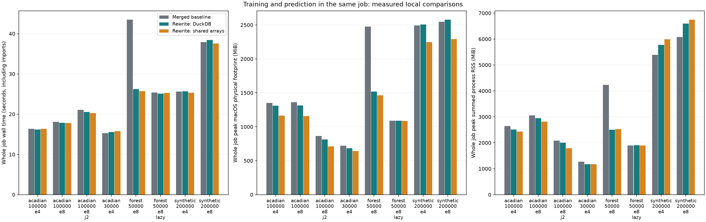
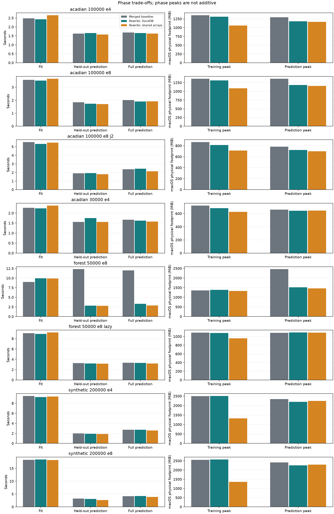

# AdaSTEM execution rewrite

The subsequent [prediction, profiling and modular calibration report](PIPELINE_OPTIMIZATION.md) measures further changes against the first rewrite. The benchmarks below retain their original merged-baseline comparison.

The `codex-rewrite` branch combines main's Python updates with `community_proj` and retains the existing public model API. The default input route remains native Pandas, DuckDB or Parquet. Optional shared numeric arrays reduce repeated training-window copies, and built-in planar prediction sends each task only its assigned ensemble's models.

The largest measured benefit was prediction with resident Random Forest models: the complete job fell from 43.47 to 25.72 seconds and peak macOS footprint from 2,476 to 1,465 MiB. Already lazy-loaded small forests showed almost no whole-job change. These are single local runs, not an HPC memory guarantee.

## Implementation and compatibility

- Temporal-window prequerying remains available for training and prediction. Native database workers open inputs read-only and cache one temporal window; shared workers select stixel rows from read-only row-major NumPy maps grouped by dtype.
- Queued training and prediction tasks are bounded to the worker count. Completion can be consumed out of order, with model and prediction output order restored deterministically.
- `fit` adds trailing optional arguments `training_data_backend`, `inner_max_num_threads`, and `max_concurrent_ensembles`. Existing constructor and positional call conventions remain intact. `execution_info_` records preparation/training times, backend, workers and shared-file size.
- `make_training_databases`, `make_duckdb_database` and the `training_databases` context manager prepare numeric Pandas inputs without manual SQL or ID columns. Pandas target labels align by ID; array labels align by position. Source frames remain unchanged. Temporary input and shared-file cleanup is explicit.
- Custom prediction overrides retain full model context. SphereAdaSTEM keeps its native route; unsupported shared-training overrides raise an explicit error. Arbitrary compatible base estimators still receive Pandas stixel data.
- Single-class stixels retain their intended constant zero/one predictions. Absent or untrained coverage retains missing predictions and the existing minimum-ensemble requirement.
- Correctly spelled quadtree options are accepted alongside existing misspelled aliases. Importing the package no longer overwrites user thread settings or suppresses warnings globally.

Three correctness changes intentionally differ from the merged baseline. Bootstrap occurrences are selected once instead of multiplying duplicate IDs again; logit aggregation no longer replaces positive probabilities with zero; and named Series targets retain their labels and validate index alignment. Bootstrap validation uses a direct resampling oracle because matching the old duplicate-row bug would be incorrect.

This is an execution optimization, not a replacement for probability calibration. No calibration map, copula estimator, sampling weights, or base-model hyperparameter space is automatically changed.

## Benchmark design

Baseline: merge commit `368acf6`, before the execution rewrite. Each case runs baseline, native rewrite and shared rewrite in fresh processes with identical fixtures and seeds. Partitioning, fitting, held-out prediction, metric evaluation and full prediction occur in the same process. Database creation is included in complete-job time and memory. Baseline uses manual preparation; rewrite uses the new helper. Both use one DuckDB thread and a 500 MB database buffer budget. Unneeded source frames are released before fitting.

Real fixtures sample the supplied Acadian Flycatcher checklist database during DOY 121–200, ordered by hashed observation ID to avoid a first-rows geographic sample. The 30,000-row sample contains 222 detections; the 100,000-row sample contains 786. Real cases have 116 numeric predictors including coordinates. Synthetic cases have 131 or 35 predictors including coordinates. Held-out splitting is random and fixed across variants; these tests measure execution equivalence, not spatial generalization or calibration quality.

Small XGBoost models use 20 trees, depth 4 and one estimator thread. Forest cases use 40 trees, depth 12 and one estimator thread. Cases use four workers except Acadian 30,000 and `e8_j2`, which use two. Lazy loading is enabled except for `forest_50000_e8`. Bootstrap is disabled in baseline comparisons; bootstrap correctness is tested separately.

Host: macOS 15.7.7, Apple Silicon arm64, 14 logical CPUs; Python 3.13.15, NumPy 2.5.1, Pandas 3.0.5, DuckDB 1.5.5, sklearn 1.9.0 and XGBoost 3.3.0. Results contain one run per variant in a fixed order. Import time, filesystem caching, instrumentation and short phase durations limit small timing comparisons. Repeat cases on the intended hardware for production decisions.

## Complete job results

MiB means 2^20 bytes. Footprint is the maximum sampled sum of process-tree macOS physical footprints; RSS is the maximum sampled sum of resident process memory. RSS counts shared pages repeatedly. The two maxima can occur at different times. Neither is Slurm cgroup memory or GPU device memory.

| Case | Variant | Job seconds | Peak footprint MiB | Peak summed RSS MiB | Peak phase |
| --- | --- | ---: | ---: | ---: | --- |
| acadian_100000_e4 | Merged baseline | 16.36 | 1351 | 2648 | training |
| acadian_100000_e4 | Rewrite native | 16.20 | 1310 | 2516 | training |
| acadian_100000_e4 | Rewrite shared | 16.34 | 1163 | 2435 | prediction |
| acadian_100000_e8 | Merged baseline | 18.11 | 1363 | 3053 | prediction |
| acadian_100000_e8 | Rewrite native | 17.88 | 1315 | 2945 | training |
| acadian_100000_e8 | Rewrite shared | 17.81 | 1156 | 2815 | prediction |
| acadian_100000_e8_j2 | Merged baseline | 21.10 | 865 | 2082 | training |
| acadian_100000_e8_j2 | Rewrite native | 20.53 | 814 | 2008 | training |
| acadian_100000_e8_j2 | Rewrite shared | 20.29 | 712 | 1788 | training |
| acadian_30000_e4 | Merged baseline | 15.26 | 721 | 1276 | training |
| acadian_30000_e4 | Rewrite native | 15.57 | 683 | 1172 | training |
| acadian_30000_e4 | Rewrite shared | 15.80 | 645 | 1177 | prediction |
| forest_50000_e8 | Merged baseline | 43.47 | 2476 | 4233 | heldout_prediction |
| forest_50000_e8 | Rewrite native | 26.22 | 1517 | 2506 | prediction |
| forest_50000_e8 | Rewrite shared | 25.72 | 1465 | 2527 | prediction |
| forest_50000_e8_lazy | Merged baseline | 25.38 | 1088 | 1899 | training |
| forest_50000_e8_lazy | Rewrite native | 25.07 | 1091 | 1909 | prediction |
| forest_50000_e8_lazy | Rewrite shared | 25.30 | 1087 | 1897 | prediction |
| synthetic_200000_e4 | Merged baseline | 25.63 | 2491 | 5396 | training |
| synthetic_200000_e4 | Rewrite native | 25.64 | 2506 | 5777 | training |
| synthetic_200000_e4 | Rewrite shared | 25.34 | 2248 | 5989 | prediction |
| synthetic_200000_e8 | Merged baseline | 37.89 | 2549 | 6075 | training |
| synthetic_200000_e8 | Rewrite native | 38.45 | 2577 | 6594 | training |
| synthetic_200000_e8 | Rewrite shared | 37.56 | 2291 | 6745 | prediction |

The shared backend lowered footprint by about 15% in the 100,000-row/eight-ensemble Acadian case, with nearly unchanged total runtime. Reducing shared execution from four to two workers lowered footprint from 1,156 to 712 MiB while training rose from 3.43 to 5.26 seconds. Total ensemble count remained eight.

For 200,000 synthetic rows/eight ensembles, footprint fell from 2,549 to 2,291 MiB, but summed RSS rose from 6,075 to 6,745 MiB. Shared mappings and page residency are a plausible contributor; these measurements do not isolate page accounting from every other allocation. This is a reason to retain both measures and test Linux cgroup memory rather than infer an HPC allocation from Mac footprint alone.

Native rewrite performance is not uniformly better: synthetic cases showed similar or slightly higher peak footprint, and resident forest training took longer in the measured rewrite run. The resident forest's prediction improvement still reduced the complete-job peak and total time. With lazy forests, model payload was already unloaded between uses, so the additional optimization produced little benefit.



## Phase measurements

Fit time below includes shared-input preparation where applicable, but excludes the separately measured partitioning phase. Memory columns are phase peaks, not values to add together. Metric evaluation is short enough to fall between 100 ms memory samples; missing samples are stored as null rather than zero.

| Case | Variant | Partition s | Fit s | Held-out prediction s | Evaluation s | Full prediction s | Train footprint MiB | Prediction footprint MiB |
| --- | --- | ---: | ---: | ---: | ---: | ---: | ---: | ---: |
| acadian_100000_e8 | Merged baseline | 1.02 | 3.56 | 1.85 | 0.0094 | 2.02 | 1363 | 1363 |
| acadian_100000_e8 | Rewrite native | 1.01 | 3.51 | 1.72 | 0.0095 | 1.90 | 1315 | 1184 |
| acadian_100000_e8 | Rewrite shared | 1.01 | 3.65 | 1.70 | 0.0075 | 1.91 | 1088 | 1156 |
| forest_50000_e8 | Merged baseline | 0.84 | 9.00 | 12.36 | 0.0071 | 12.01 | 1357 | 2464 |
| forest_50000_e8 | Rewrite native | 0.82 | 9.94 | 2.81 | 0.0058 | 3.29 | 1384 | 1517 |
| forest_50000_e8 | Rewrite shared | 0.85 | 9.90 | 2.79 | 0.0060 | 2.88 | 1327 | 1465 |
| synthetic_200000_e8 | Merged baseline | 1.30 | 18.32 | 3.20 | 0.0151 | 4.19 | 2549 | 2409 |
| synthetic_200000_e8 | Rewrite native | 1.36 | 18.48 | 3.08 | 0.0139 | 4.26 | 2577 | 2254 |
| synthetic_200000_e8 | Rewrite shared | 1.37 | 18.20 | 2.65 | 0.0116 | 3.89 | 1361 | 2291 |



## Memory attribution

The raw reports distinguish logical data payload, shared files, saved models, parent/descendant process RSS, and observed increases around estimator fitting. These quantities overlap and do not form an exact additive decomposition of resident memory. Native estimator workspaces, allocator retention, imported libraries and page cache cannot be separated exactly through a generic sklearn interface.

For the 100,000-row/eight-ensemble Acadian case:

| Measurement | Baseline | Rewrite native | Rewrite shared | Meaning |
| --- | ---: | ---: | ---: | --- |
| Input payload MiB | 46.16 | 46.16 | 46.16 | Logical input data; not an extra RAM charge |
| Estimated largest window MiB | 21.74 | 21.74 | 21.74 | Logical window size before estimator processing |
| Shared input files MiB | 0.00 | 0.00 | 36.35 | Temporary disk payload; mapped pages also appear in process accounting |
| Saved fitted models MiB | 3.87 | 3.87 | 3.87 | Serialized model files; not model resident RAM |
| Largest stixel DataFrame MiB | 8.26 | 8.26 | 8.26 | Logical estimator input; arrays may share storage |
| Largest fit RSS increase MiB | 34.55 | 27.48 | 33.36 | Observed before/after change; includes preprocessing and retained allocations |
| Training parent RSS peak MiB | 649.58 | 636.39 | 689.41 | Parent phase maximum |
| Training descendants RSS peak MiB | 2297.28 | 2308.78 | 1790.38 | Workers and trackers; maximum may differ from parent peak |

Sampling also records the simultaneous logical payload of active stixel frames and RSS increases above each active fit's starting point. A before/after increase can miss a transient workspace peak; the independent process sampler is the broader peak measurement. Summed per-stixel fit seconds represent work across workers and are not wall time.

The memory sampler traverses all children and grandchildren. An early macOS sampler incorrectly interpreted the child-PID count and omitted workers; all affected reports are marked invalid under `data/00_benchmarks/invalid_sampler` and excluded from these tables. Every report used here has `sampler_version=2`. A regression test starts three children and three grandchildren with known allocations to check complete traversal.

## Output equivalence and validation

All 24 benchmark jobs completed. All eight cases produced exactly matching held-out and full predictions, including missing-coverage masks, across baseline/native/shared variants. Maximum absolute prediction differences were zero. AUC, Brier, log loss and coverage were recorded as equivalence checks; no improved calibration claim follows from them.

Validation included 54 new regression checks on Python 3.13 and the new execution/data-preparation checks on Python 3.14. Earlier staged compatibility validation passed 49 existing tests covering model families, DuckDB/Parquet input, lazy loading, custom methods, filtering, saving/loading, model selection, bootstrap and reproducibility. Following the final prediction change, the current code also passed the existing regression/separate-ensemble, hurdle, parallel SphereAdaSTEM and STEM regression tests, plus the 14 existing custom/filtering/save-load/model-selection checks on Python 3.14.

The controlled parallel-failure test uses cooperative joblib teardown because this sandbox denies worker signals; production force-kill behavior is unchanged and needs a scheduler integration check.

The original example notebooks remain unchanged because they need external Mallard and prediction datasets. The added offline notebook was executed with bundled data and contains real tables and plots. Its HTML rendering was checked. The site preview uses a local build with social-card font downloading disabled because the sandbox cannot reach Google Fonts; the production configuration retains the original social plugin.

## Use and reproduce

See the [parallel execution guide](../docs/Tips/Tips_for_parallel_execution.md) and [executed notebook](../docs/Examples/10.Execution_and_memory.ipynb). From a configured environment at the repository root:

```bash
python -m pytest -q tests/test_execution_rewrite.py tests/test_data_preparation.py tests/test_benchmark_memory.py
python scripts/00_benchmarks/run_matrix.py --repeat 3 --output-dir data/00_benchmarks/repeated
python scripts/01_documentation/execute_notebook.py docs/Examples/10.Execution_and_memory.ipynb --output docs/Examples/10.Execution_and_memory.ipynb
```

For a standalone HPC comparison, `compare_execution.py` accepts `--x-database`, `--species-parquet`, `--rows`, `--jobs`, `--ensembles`, `--input`, `--base-model` and `--output`. Keep the complete job within one scheduler allocation, retain the JSON report, and check Slurm accounting as well as the process sampler. Source files are opened read-only. Scratch fixtures and model files are temporary.

Keep `native` as the portable default. Use shared arrays when a target-platform comparison shows a useful memory/time trade-off. Keep base estimator threads explicit, and choose training and prediction worker counts separately. `max_mem` is a DuckDB buffer setting, not a worker or job RAM cap. The changes do not impose a hard estimator workspace bound or automatically schedule by memory.

Linux execution, multi-node scheduling and GPUs are not validated by these local measurements. Existing backend selection remains available; shared-file paths must be visible to every worker. GPU device allocations need separate profiling, and the package does not assign GPUs. A full-data HPC run with the actual tuned/calibrated estimator remains necessary before selecting production cores and memory.
